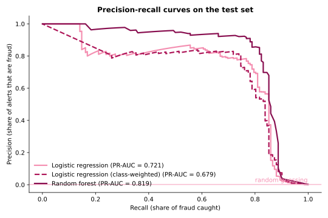
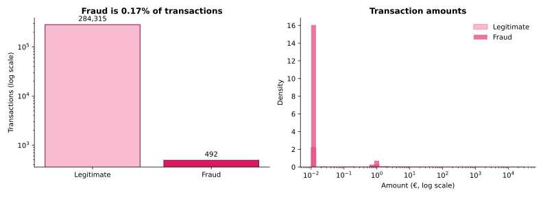
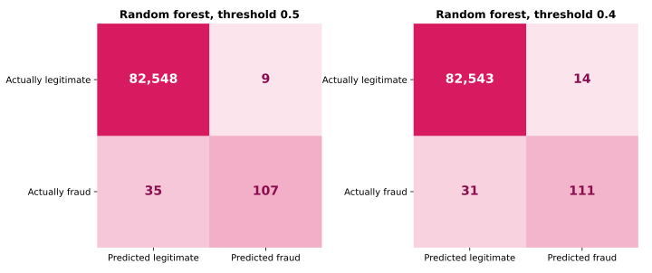
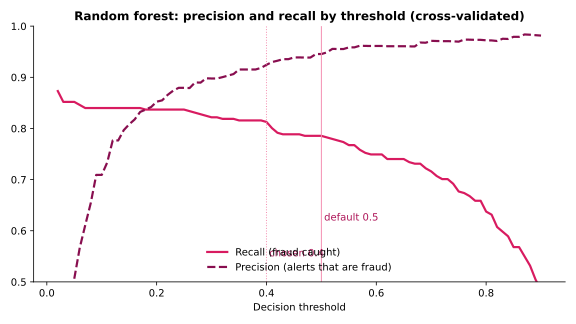

# Credit Card Fraud Detection: Why 99.8% Accuracy Can Be Useless

Detecting fraud in 284,807 credit card transactions where only 0.17% are fraudulent: why accuracy is the wrong measure, how logistic regression and a random forest compare on precision and recall, and how the decision threshold changes the trade-off.

**Python · pandas · matplotlib · scikit-learn · imbalanced classification · precision / recall · PR-AUC · threshold tuning · cross-validation**

## Questions

1. When fraud is less than 0.2% of transactions, how should a fraud model be evaluated?
2. How much fraud can logistic regression and a random forest catch, and how many false alarms does that cost?
3. How does the choice of decision threshold change the trade-off?

## Data

[Credit Card Fraud Detection dataset](https://www.openml.org/d/1597) (Dal Pozzolo et al., 2015), collected by Worldline and the Machine Learning Group at Université Libre de Bruxelles, licensed under the Open Database License.

- 284,807 transactions by European cardholders over two days in September 2013
- 492 are fraud (0.173%, about 1 in 579)
- 28 anonymised features (principal components `V1` to `V28`) plus the transaction amount
- No missing values. 9,144 exact duplicate rows were removed before modelling.

The file is about 150 MB, so it is not stored in this repository. The notebook downloads it from OpenML the first time it runs.

## Method

1. **Framing.** Showed that a model predicting "legitimate" for everything is 99.83% accurate, and chose precision, recall and PR-AUC as the evaluation measures.
2. **Train/test split.** 70% training (192,964 transactions) / 30% testing (82,699 transactions), stratified to keep the fraud rate equal, and seeded so it can be reproduced.
3. **Models.** Logistic regression, logistic regression with class weights, and a 200-tree random forest.
4. **Threshold selection.** Used 5-fold cross-validated predictions on the training set to study precision and recall at each threshold, without touching the test set.
5. **Final evaluation.** Applied the chosen threshold once to the test set.

## Results

| Model | Accuracy | Precision | Recall | PR-AUC | Fraud caught | False alarms |
|---|---|---|---|---|---|---|
| Baseline (always "legitimate") | 0.9983 | — | 0.000 | 0.002 | 0 of 142 | 0 |
| Logistic regression | 0.9991 | 0.868 | 0.556 | 0.721 | 79 of 142 | 12 |
| Logistic regression (class-weighted) | 0.9773 | 0.064 | 0.901 | 0.679 | 128 of 142 | 1,867 |
| Random forest (threshold 0.5) | 0.9995 | 0.922 | 0.754 | 0.819 | 107 of 142 | 9 |
| **Random forest (threshold 0.4)** | 0.9995 | **0.888** | **0.782** | 0.819 | **111 of 142** | **14** |

All metrics are on the 82,699 test transactions the models never saw.



## Key findings

**1. Accuracy is misleading when the outcome is rare.** Calling every transaction legitimate is 99.83% accurate and catches nothing. The class-weighted model caught the most fraud and had the *lowest* accuracy.



**2. The random forest gave the best balance.** At a threshold of 0.4 it caught **78% of fraud** (77% by value) with only **14 false alarms** in 82,699 transactions, so 89% of its alerts were real. That is about 151 alerts per 100,000 transactions.



**3. Catching more fraud gets expensive quickly.** Class-weighted logistic regression caught 90% of fraud but raised 1,867 false alarms, and only 6% of its alerts were real. For the random forest, lowering the threshold below about 0.2 barely improves recall while false alarms multiply.



**4. ROC-AUC and PR-AUC disagreed.** ROC-AUC ranked the random forest last (0.948) and the class-weighted model first (0.973), the opposite of the precision-recall results. With 0.17% fraud, PR-AUC is the more honest measure.

**5. Fraud is not about large amounts.** The median fraud is €9.25, below the median legitimate transaction (€22), and the amount ranks 22nd of 29 features by importance. Five anonymised features account for 56% of the model's importance.

## Limitations

- **Two days of data from 2013.** Fraud patterns change quickly, so this says little about performance today. A real system would be retrained and monitored continuously.
- **Random train/test split.** In production a model predicts the future from the past, which is harder, so these results are probably optimistic. The copy of the data used here has no time column, so a time-based split was not possible.
- **Anonymised features.** The inputs are principal components, so the model cannot be explained in business terms.
- **Few fraud cases.** The test set has 142 frauds, so each one moves recall by 0.7 points. The difference between thresholds 0.4 and 0.5 (4 more frauds caught, 5 more false alarms) is within that noise.
- **No cost data.** I chose the threshold by F1 score. A bank would choose it from the cost of missed fraud against the cost of reviewing alerts.

## Repository structure

```
├── credit_card_fraud_detection.ipynb    # full analysis with code, outputs and written interpretation
├── data/                                # created on first run (dataset is downloaded, not stored here)
└── images/                              # charts used in this README
```

## How to run

```bash
pip install pandas numpy matplotlib scikit-learn jupyter
jupyter notebook credit_card_fraud_detection.ipynb
```

Run all cells from the repository folder. The first run downloads the dataset (about 150 MB) and the full notebook takes a few minutes.

---

**Author:** María Sofía Montoya-Chang · M.S. in Data Analytics · [LinkedIn](https://www.linkedin.com/in/maria-montoya-chang)

Data: Dal Pozzolo, A., Caelen, O., Johnson, R. A., & Bontempi, G. (2015). Calibrating Probability with Undersampling for Unbalanced Classification. IEEE Symposium on Computational Intelligence and Data Mining.
